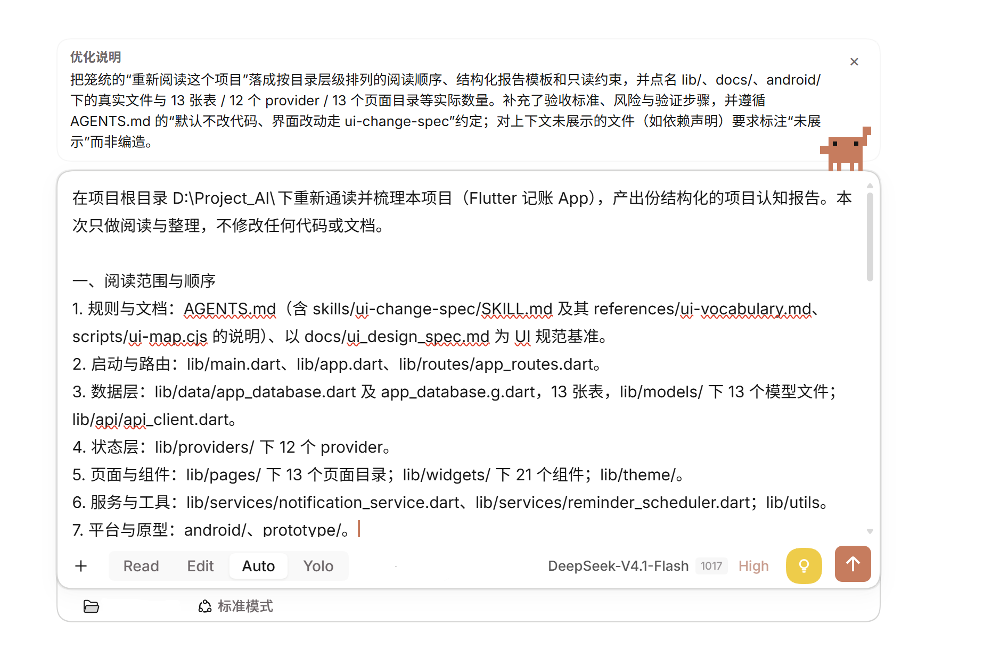
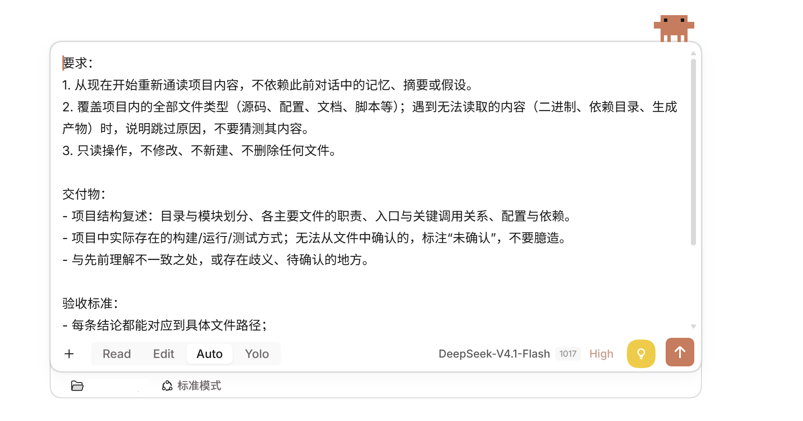
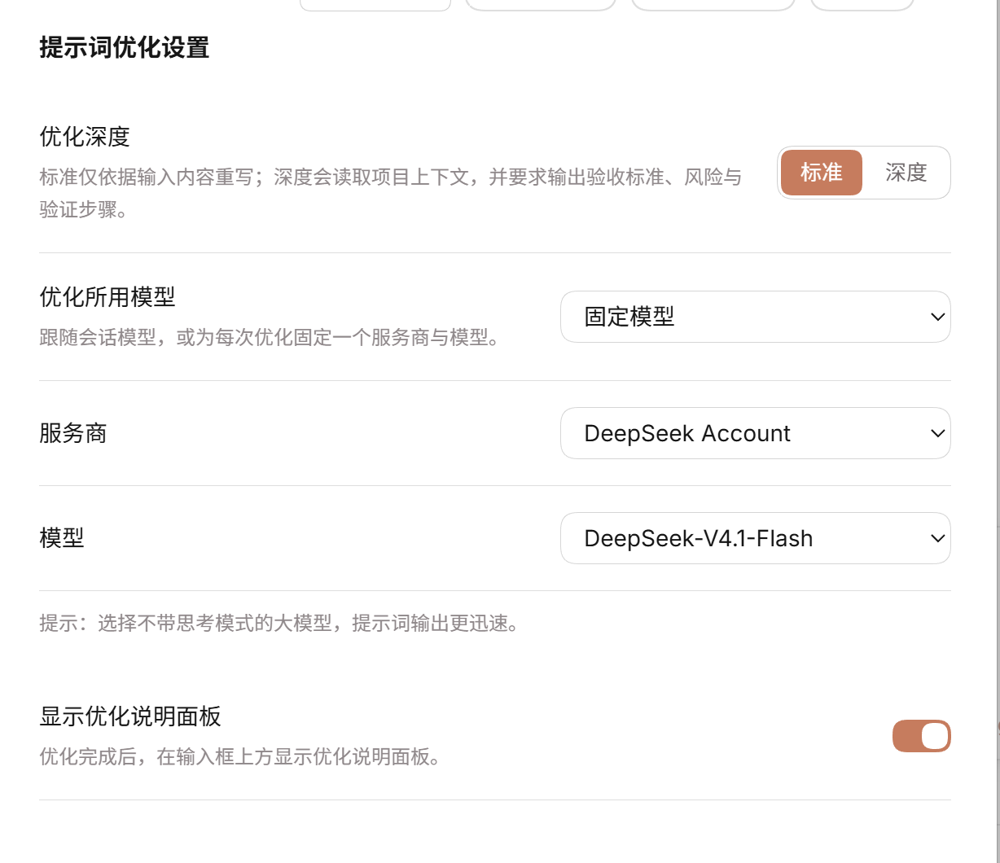

# Prompt Optimizer

**一个 [DeepSeek Harness](https://github.com/deepseek-ai)（DSH）插件：结合当前项目的技术栈、代码结构与约定，优化你的提示词。**

通过输入框图标按钮和 Agent 工具手动触发——绝不自动改写任何内容。

---

[中文](#中文) | [English](#english)

---

## 中文

### 这个插件做什么

点击发送按钮旁边的**灯泡**图标，插件会读取你工作目录的文件结构、关键配置文件（`package.json`、`tsconfig.json` 等）和代码约定，连同你的草稿一起发给 LLM，然后把优化后的提示词写回输入框。优化说明显示在输入框上方的面板里。

### 截图

优化深度设为「深度」时的结果——输入框上方是优化说明面板，正文把“重新通读项目”落成按目录层级排列的阅读顺序、结构化报告模板和只读约束：



优化深度设为「标准」时的结果——提示词被整理成要求、交付物与验收标准三段：



设置页——优化深度、优化所用模型、服务商与模型选择，以及说明面板开关：



> 前两张图底部工具条上的「标准模式」是 DSH 自身的会话模式，与本插件的**优化深度**（标准/深度）是两回事，二者互不影响。

### 功能

| 功能 | 说明 |
|------|------|
| **图标按钮** | 位于输入框工具栏，发送按钮左侧——黄色圆形按钮，灯泡图标 |
| **Agent 工具** | `optimize_prompt`，会话中的 Agent 可以调用 |
| **斜杠命令** | `/optimize <文本>`，直接使用 |
| **说明面板** | 在输入框上方显示优化说明；输入框清空后自动关闭；可在设置的「提示词优化」页用开关隐藏 |
| **模型选择** | 在设置页选择优化所用的模型：跟随会话模型，或固定一个服务商与模型（经 DSH settings 表单持久化） |
| **流式回填** | 模型生成过程中把重写的提示词逐段写回输入框；进度经插件 Remote 通道读取，不会额外写入会话日志 |
| **优化深度** | 设置页两档切换：「标准」仅依据输入框内容优化；「深度」额外读取项目上下文，并要求模型输出验收标准、风险与验证步骤 |
| **双语界面** | 支持中英文 |
| **主题适配** | 使用 DSH 的 CSS 变量，明暗主题通用 |

### 项目上下文收集（仅深度模式）

后端扫描工作目录，收集：

- **技术栈标记** — `package.json`、`Cargo.toml`、`go.mod`、`pyproject.toml` 等
- **配置文档** — `README.md`、`CONTRIBUTING.md`、`.editorconfig` 等
- **工具链文件** — `tsconfig.json`、`.eslintrc`、`prettier.config.js` 等
- **源代码文件** — 在字符预算内采样，跳过 `node_modules`、`.git`、`dist` 等目录

### 安装

```bash
dsh plugin add https://github.com/lucky6star9/prompt-optimizer-keep
```

安装后在 DSH 的插件管理器里启用这个 bundle。

---

## English

### What it does

Click the **light bulb** icon next to the send button. The plugin reads your workspace's file structure, key config files (`package.json`, `tsconfig.json`, etc.), and source code conventions, sends them together with your draft prompt to the LLM, and writes back an optimized version. The optimization notes appear in a panel above the input box.

### Screenshots

With optimization depth set to **deep**: the notes panel above the input box, with the rewrite turning "re-read the project" into a directory-level reading order, a report template, and read-only constraints:


With optimization depth set to **standard**: the prompt reshaped into requirements, deliverables, and acceptance criteria:


The settings page — optimization depth, the model route, and the notes-panel switch:


> The "standard mode" in the composer toolbar of the first two shots is DSH's own session mode. It is unrelated to this plugin's **optimization depth** (standard / deep); the two do not affect each other.

### Features

| Feature | Description |
|---------|-------------|
| **Icon button** | Sits left of the send button in the composer toolbar — a yellow circular button with a light bulb icon |
| **Agent tool** | `optimize_prompt` is available to any agent in the session |
| **Slash command** | `/optimize <text>` for direct use |
| **Notes panel** | Shows above the input box with optimization rationale; auto-dismisses when you clear the draft; can be hidden from the plugin's settings page |
| **Model selection** | Pick the model the optimizer runs on in the settings page: follow the session model, or pin a fixed provider and model (persisted through DSH's settings forms) |
| **Live fill** | Writes the rewrite into the composer while the model generates it; progress travels over the plugin's own Remote channel, so no extra session-log entries appear |
| **Optimization depth** | Two-stop toggle in the settings page: **Standard** rewrites the draft alone; **Deep** also reads the project context and asks the model for acceptance criteria, risks, and verification steps |
| **Bilingual** | English and Chinese UI strings |
| **Theme-aware** | Uses DSH's CSS variable tokens, works in both light and dark themes |

### Project context gathering (deep mode only)

The host scans the working directory for:

- **Stack markers** — `package.json`, `Cargo.toml`, `go.mod`, `pyproject.toml`, etc.
- **Config docs** — `README.md`, `CONTRIBUTING.md`, `.editorconfig`, etc.
- **Toolchain files** — `tsconfig.json`, `.eslintrc`, `prettier.config.js`, etc.
- **Source files** — sampled up to a character budget, skipping `node_modules`, `.git`, `dist`, etc.

### Install

```bash
dsh plugin add https://github.com/lucky6star9/prompt-optimizer-keep
```

Then enable the bundle in your DSH profile via the Plugin Manager.

---

## License / 许可证

MIT © luckystar6
